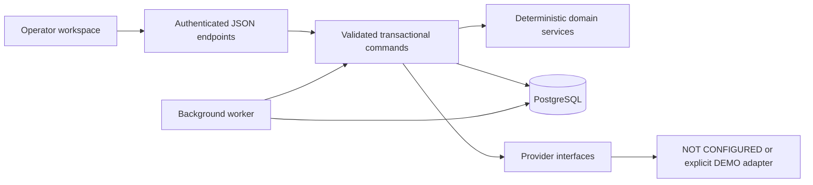

# Architecture

## Application boundary

Next.js serves the React operator interface and authenticated JSON endpoints. Business calculations live in `src/lib/domain.ts`; persistence, workflow commands and agent execution live in the server service layer. PostgreSQL is the canonical store. UI state is a view of server records, never an authoritative financial ledger or permission check.

The application is separate from the original AI Memory Vault notes and templates. It does not execute the memory-vault build instructions or use those documents as business policies.

The `/os` [Agentic OS](AGENTIC-OS.md) interface is a command layer over the same canonical services. An authenticated `/api/os` endpoint handles actor/mode-scoped sessions, transcripts, memory and run requests. A local deterministic router, or an optional validated OpenAI planner, selects one bounded skill. The durable worker executes that skill through existing permission-checked business commands. The model has no database, approval or shell tools, and reference memory is never executable policy.

## Record and calculation model

Each business record has a UUID and an explicit DEMO/LIVE mode. Properties also have a stable human-readable Deal ID. Entity relationships are relational columns with foreign keys; extensible domain attributes are JSONB payloads. The service validates payloads and only exposes supported commands. This is a typed TypeScript service over `pg`, not a generated type-safe ORM; payload typing remains an area for further hardening.

Money is entered in dollars. Additions and subtractions in the domain module use integer cents; percentage outputs are rounded at service boundaries. Dates are persisted in PostgreSQL and deadline records are distinct from descriptive calendar text. No LLM is an authoritative calculator.

ARV uses sourced eligible comparable sales weighted by distance and recency. Repairs use itemized low/expected/high ranges with an explicit contingency. Underwriting subtracts repair, investor profit, holding, transaction and risk assumptions from ARV, then subtracts the company assignment target to produce MAO. Scenarios make uncertainty visible. Projected revenue and estimated probability-weighted pipeline are separate from ledger revenue.

## Durable work

The jobs table persists work across worker restarts. Jobs have a mode, entity link, status, attempt count, next eligible run, lock time, structured error and idempotency key. Run the worker as a separate process in production. Publication or snapshot restoration does not preserve a live worker process.

Agent execution is bounded server code with defined tools and result fields. Agent names do not imply independent general-purpose AI research or configured external access. Missing provider access blocks the affected operation and must remain visible. Agent access descriptions are application-level policy; the current implementation does not provision a separate PostgreSQL login for every agent.

All 16 primary agent names have bounded deterministic executors. Listed sub-agents are descriptive delegation groups, not separate schedulable agents or independent controls. BLOCKED results remain distinct from completed work. Failed authenticated operations persist structured evidence in `operation_errors`, surfaced in Activity; durable jobs retain their own attempts and structured errors.

Owner-only file uploads stream through a bounded request reader, verify supported PDF/PNG/JPEG/text content signatures and size, and save metadata plus binary bytes transactionally. Mode-scoped authenticated downloads return attachments with restrictive headers. This storage feature does not implement external e-signature, malware scanning or managed object storage.

## Evolution

Keep new workflow rules in shared domain services and transactional commands. Add versioned migrations for schema changes. Avoid adding browser-only permission checks or direct UI writes to PostgreSQL. See [status](STATUS.md) for incomplete features and [decisions](DECISIONS.md) for tradeoffs.
